  

  
  

 

  

Desarrollo **plataformas web, aplicaciones de escritorio y aplicaciones Android** para empresas, desde la base de datos y el backend hasta el frontend y el despliegue en servidores Linux.

 

| Proyecto | Qué resuelve | Tecnologías |
|:---|:---|:---|
| **[Rixkia](https://rixkia.com)** | Alerta temprana de riesgos naturales en el Perú: sismos, huaicos, crecidas, incendios, oleaje, volcanes y calidad del aire, con mapas en tiempo real y modelos de machine learning. | FastAPI · PostgreSQL/PostGIS · Redis · Celery · Next.js · Docker |
| **[Acá Tu Chamba](https://acatuchamba.com.pe)** | Bolsa de trabajo con validación automática de pagos Yape/Plin, generador de CV con IA y app Android nativa. | React · TypeScript · FastAPI · MySQL · AWS S3 · Kotlin |
| **[Tkapacito](https://tkapacito.com)** | Capacitación para empresas: cursos en video, evaluaciones y certificados en PDF. | FastAPI · Jinja2 · MySQL · GitHub Actions |
| **SistemaGeoxcava / SistemaGeoLab** | Apps de escritorio multiusuario para laboratorios de geomecánica: cotizaciones, órdenes de servicio y reportes. | Python · PyQt6 · MySQL · ReportLab |
| **[PXL Holding](https://pxlholding.com)** | Sitio web corporativo. | HTML5 · CSS3 · Bootstrap |

🔒 El código de estos proyectos es privado porque pertenece a cada cliente. Los enlaces llevan a los sitios en funcionamiento.

  

<table align="center">
  <tr>
    <td align="right"><b>Lenguajes</b></td>
    <td> + SQL</td>
  </tr>
  <tr>
    <td align="right"><b>Backend</b></td>
    <td> + SQLAlchemy · Celery · Alembic</td>
  </tr>
  <tr>
    <td align="right"><b>Frontend y móvil</b></td>
    <td> + Jetpack Compose · PyQt6</td>
  </tr>
  <tr>
    <td align="right"><b>Bases de datos</b></td>
    <td> + SQL Server · PostGIS</td>
  </tr>
  <tr>
    <td align="right"><b>Infraestructura</b></td>
    <td></td>
  </tr>
</table>

 

  

 

<b>Proyectos académicos y de práctica</b> (clic para ver)

 

| Repositorio | Descripción | Stack |
|:---|:---|:---|
| [nogal-landing](https://github.com/AcuLuis/nogal-landing) | Landing de una empresa ficticia de muebles con arquitectura cloud en AWS. | S3 · CloudFront · Lambda |
| [ProyectoRestaurant](https://github.com/AcuLuis/ProyectoRestaurant) | Sistema de inventarios y reportes para un restaurante. | Java · Maven · SQL Server |
| [Nasa_Web](https://github.com/AcuLuis/Nasa_Web) | Interfaz web con la API abierta de imágenes de la NASA. | Vue |
| [GraficadorGrafosRecorridos](https://github.com/AcuLuis/GraficadorGrafosRecorridos) | Visualización de BFS, DFS, Kruskal y Dijkstra. | Python |
| [LeetcodeProblemas](https://github.com/AcuLuis/LeetcodeProblemas) · [KattisProblemas](https://github.com/AcuLuis/KattisProblemas) | Resolución de problemas de algoritmos. | Algoritmos |

 

  

